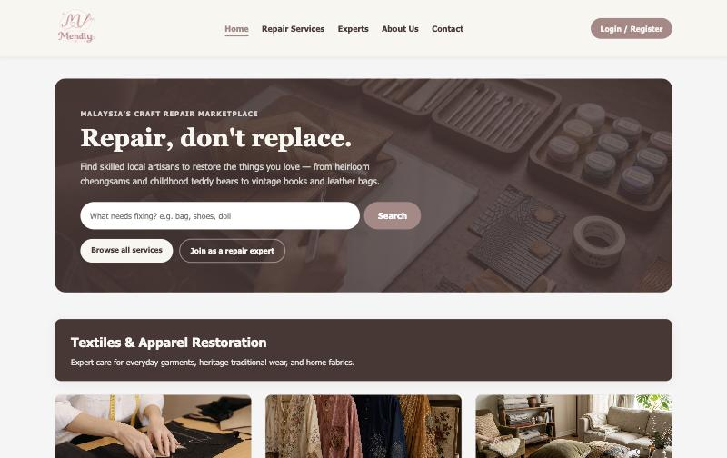
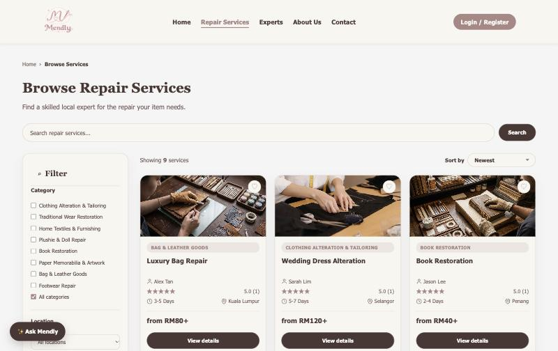
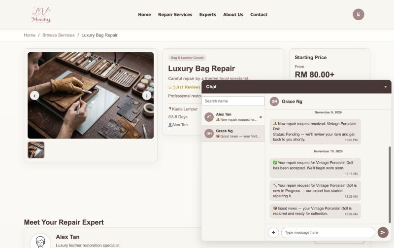
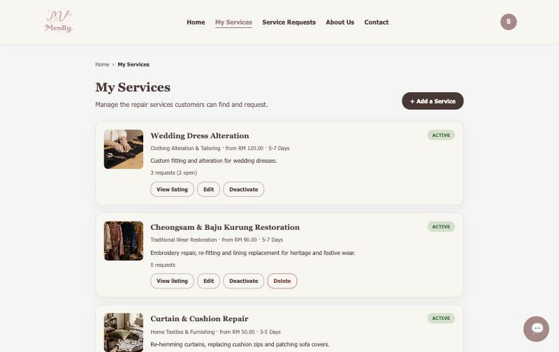
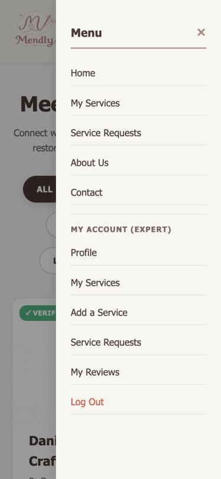
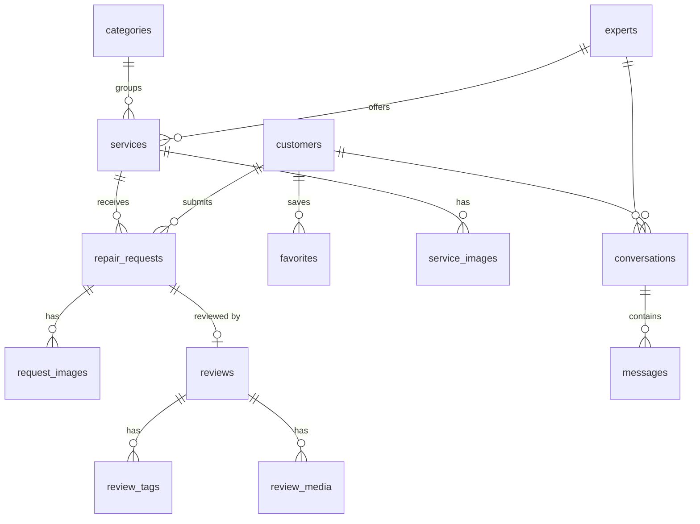

# Mendly — craft repair marketplace

[](https://github.com/zijing0907/mendly/actions/workflows/ci.yml)


Mendly connects people who want to **repair rather than replace** their belongings with independent repair
artisans in Malaysia: tailors, cobblers, book binders, plushie "doctors" and leather workers. Customers browse
services, save favourites, submit repair requests with photos, chat with the expert, and review the finished
job. Experts list services and move each request through a tracked workflow that sends automatic chat updates
to the customer.

Built with **vanilla PHP, MySQL, HTML, CSS and JavaScript**. Frameworks and libraries were not allowed in this
course, so routing, auth, validation, the chat widget and the responsive layout are all hand-written.



## Features

**Customers**
- Browse and search services with filters for category, location, price and rating, plus sorting and pagination
- Service detail pages with a photo gallery, expert profile and reviews
- Favourites / wishlist, toggled in place with `fetch()`
- Submit repair requests with up to 5 reference photos; cancel while still pending
- Track request status: Pending → Accepted → In Progress → Ready for Collection → Completed
- Leave a review with star rating, tags and photo/video attachments
- Floating chat widget for messaging experts, with image/video attachments

**Repair experts**
- Self-registration with a business profile; first login goes straight to creating a listing
- **My Services** dashboard: create, edit, deactivate and delete listings, with up to 6 photos each
- Manage incoming requests; each status change posts an automatic chat message to the customer
- Public reviews page

**Everyone / admin**
- Registration and login for two account types, with **Remember me** (stays signed in for 30 days)
- Profile editing with photo upload, password change, account deletion
- Password reset by email over SMTP, or an on-screen link in demo mode when no mail server is configured
- Contact form, with an admin inbox (`/admin`) for triaging inquiries
- Fully responsive layout using only CSS media queries, with a slide-out drawer on mobile

| Browse & filter | Chat with an expert |
| --- | --- |
|  |  |

| Expert dashboard | Mobile |
| --- | --- |
|  |  |

## Tech stack

| Layer | Technology |
| --- | --- |
| Front end | HTML5, CSS3 (custom properties, Grid/Flexbox, media queries), vanilla JavaScript (`fetch`, DOM APIs) |
| Back end | PHP 8 (procedural, `mysqli` prepared statements, sessions) |
| Database | MySQL 8 / MariaDB, 16 tables with foreign keys and cascades |
| Tooling | GitHub Actions CI: PHP lint on 8.1–8.3 plus an end-to-end smoke test against a real MySQL |

## Security notes

- **SQL injection:** every query that takes user input uses `mysqli` prepared statements, including the
  dynamic filter query on Browse Services.
- **Passwords:** stored with `password_hash()` (bcrypt) and checked with `password_verify()`. The session ID is
  regenerated on login.
- **XSS:** server output goes through `htmlspecialchars()`. Chat content rendered by JavaScript is escaped
  before it touches `innerHTML`.
- **File uploads:** the type is detected from the file's bytes, not its name. Files are stored under random
  names with an extension the server picks, and `uploads/.htaccess` refuses to serve scripts.
- **Access control:** every page and endpoint checks the role, and every write is scoped to the owner
  (`WHERE ... AND expert_id = ?`), so changing an ID in a request can't touch someone else's data.
- **CSRF:** every form and `fetch()` call carries a per-session secret token. One check in `helpers.php`,
  which every PHP file loads first, rejects any POST without it, so new forms are protected automatically.
- **Remember me:** the cookie holds a random selector and validator, and only a SHA-256 hash of the validator
  is stored. Tokens are single-use (replaced on every visit) and are revoked on logout, password change or
  reset, and account deletion.
- **Password reset:** one-time tokens that expire after 30 minutes. The response is the same whether or not
  the email has an account, so it can't be used to find out who is registered.
- **Config:** database and mail credentials come from environment variables or a git-ignored `.env`,
  which `.htaccess` stops Apache from serving.

## Getting started

### Option A: XAMPP (Windows / macOS)

1. Copy this folder into `htdocs/` (for example `htdocs/mendly`).
2. Start **Apache** and **MySQL** in the XAMPP control panel.
3. Open phpMyAdmin → **Import** → run `database/mendly-schema.sql`, then `database/mendly-data.sql`.
4. **macOS / Linux only:** let Apache save uploaded photos with `chmod 777 uploads`. On these systems Apache
   runs as a different user from you.
5. Visit <http://localhost/mendly/>.

The default settings match XAMPP (host `localhost`, port `3306`, user `root`, empty password). If yours
differ, copy `.env.example` to `.env` and edit it. The root `.htaccess` stops Apache from serving `.env`.

> Using the PHP built-in server with XAMPP's MySQL on a Mac? Set `DB_HOST=127.0.0.1` in `.env`, because
> `localhost` makes PHP look for a MySQL socket file in the wrong place.

### Option B: PHP built-in server

```bash
mysql -u root -p < database/mendly-schema.sql
mysql -u root -p < database/mendly-data.sql
cp .env.example .env        # then set DB_PASSWORD etc.
php -S localhost:8000
```

Then open <http://localhost:8000>. Requires PHP 8.1+ with the `mysqli` extension.

### Optional: send real password-reset emails

By default the site runs in **demo mode**: the reset link is shown on screen. That's fine on your own
computer, but don't put the site online like that. To send real emails, fill in the `MAIL_*` settings in
`.env`. With Gmail:

1. Turn on 2-Step Verification for the Google account.
2. Create an **App Password** at <https://myaccount.google.com/apppasswords>.
3. In `.env`, set `MAIL_HOST=smtp.gmail.com`, `MAIL_USERNAME` and `MAIL_FROM` to the Gmail address, and
   `MAIL_PASSWORD` to the 16-character app password with no spaces.
4. When the site is online, also set `APP_URL` (e.g. `https://mendly.example.com`) so links in emails
   point to the right address.

The SMTP client in `includes/mailer.php` is written from scratch: it handles STARTTLS and AUTH LOGIN with
no libraries.

### Demo accounts

All seed accounts use the password **`ChangeMe!2026`**.

| Role | Login |
| --- | --- |
| Customer | `emily@gmail.com` (has requests, reviews and chats) |
| Expert | `sarah@mendly.com` (3 services) or `alex@mendly.com` |
| Admin | username `admin` at `/admin/login.php` |

### Running the tests

```bash
tests/smoke-test.sh http://localhost:8000
```

The script logs in as each role, loads every page, and fails on any PHP warning or error, unexpected status
code, broken access rule, missing CSRF protection, or broken link (136 checks). Run it against a freshly seeded database. CI runs the same script
on every push.

## Project structure

```
├── index.php        home page (the site's entry point)
├── pages/           every other page a visitor opens: browse, service details, login, profile, ...
├── actions/         form handlers: validate the POST, write to the database, redirect back
├── api/             JSON endpoints called with fetch(): chat, favourites, reviews, request status
├── includes/        shared code, never requested directly (blocked by .htaccess)
│   ├── db.php           connection, .env loading, shared database helpers
│   ├── helpers.php      url()/redirect(), escaping, role checks, CSRF check, safe upload extensions
│   ├── auth.php         login sessions and "Remember me" tokens
│   ├── mailer.php       minimal SMTP client for password-reset emails
│   └── header.php, nav.php, footer.php, main.php, chat-widget.php
├── admin/           admin login and inquiry inbox
├── assets/          css/, js/, images/
├── database/        schema and seed data (blocked by .htaccess)
├── tests/           end-to-end smoke test
├── docs/            README screenshots
└── uploads/         user uploads, git-ignored; scripts can't run here
```

Pages print a `<base href>` tag pointing at the project root, and `url()` builds server-side redirects, so
the app works both at `localhost/mendly/` (XAMPP) and at the web root (`php -S`) with no configuration.

## Data model



Also: `password_resets` (one-time reset tokens), `remember_tokens` (Remember me), `inquiries` (contact form) and `admins`.

## Post-submission improvements

After the course ended I audited the codebase and fixed the problems that only show up when all the pages run
together. The full list is in the [commit history](https://github.com/zijing0907/mendly/commits/main). Highlights:

- **Fake login:** a leftover debug file logged *every* visitor in as a demo customer. It loaded because of how
  PHP resolves relative `include` paths.
- **Remote code execution:** the repair-request upload kept the user's file extension, so an image with PHP
  appended and named `.php` could be uploaded and run.
- **No admin auth:** the admin inbox, with every user's name and email, was public.
- **Stored XSS:** chat messages were inserted into the page as HTML.
- **Crashes:** four pages queried tables or columns that didn't exist. The chat only worked through the fake
  login, because it read a session key the real login never set.
- **Performance:** the home page went from ~25 MB of images to ~2.7 MB.
- **CRUD:** built the missing expert service-management page and request cancellation.

## Team & credits

Mendly was built as a four-person group assignment for **UECS2194 Web Application Development** at
Universiti Tunku Abdul Rahman (UTAR), 2026. The original team repository is
[wanxi31/WAD_Asgmt](https://github.com/wanxi31/WAD_Asgmt).

## License

Copyright © 2026 Zijing and the Mendly project team. **All rights reserved.**

This code is public for portfolio viewing only. It is not open source: please don't copy it or reuse it,
including as coursework, without permission. See [LICENSE](LICENSE).
